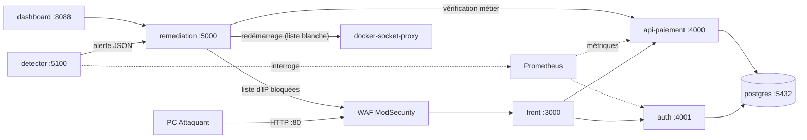
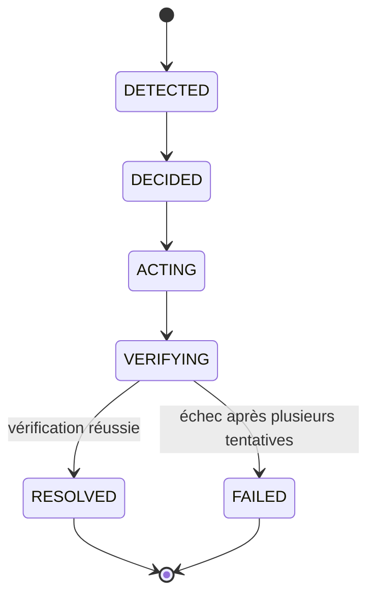

# A : Développement et moteur de remédiation

> Section du dossier d'ingénierie rédigée par la personne A.
> Les passages marqués **[À COMPLÉTER]** se remplissent au fil des jours 2 et 3 ; tout le reste décrit ce qui est déjà construit et testé.

## 1. Architecture applicative et flux

### 1.1 Vue d'ensemble

La plateforme de paiement fictive est composée de microservices conteneurisés, reliés par des réseaux Docker cloisonnés. Un seul point d'entrée est exposé au réseau du consortium : le WAF (port 80).

### 1.2 Rôle de chaque composant

| Service | Rôle | Port interne |
|---|---|---|
| `waf` | Filtrage applicatif (ModSecurity + règles OWASP CRS), seul point d'entrée publié | 8080 (publié sur 80) |
| `front` | Interface web de paiement (React) **[À COMPLÉTER : version finale]** | 3000 |
| `auth` | Authentification : émission et vérification des jetons JWT | 4001 |
| `api-paiement` | API métier : transactions, soldes, contrôle d'intégrité | 4000 |
| `postgres` | Base de données (comptes, utilisateurs, transactions) | 5432 |
| `remediation` | Moteur de remédiation : reçoit l'alerte, décide, agit, vérifie | 5000 |
| `dashboard` | Supervision pour le jury (accessible seulement en local sur le PC Hôte) | 8088 |
| `detector` | Détection d'anomalies par machine learning (responsable : C) | 5100 |

### 1.3 Cloisonnement réseau

Les réseaux Docker sont séparés (`app-net`, `data-net`, `remediation-docker-net`, `observability-net`…) et marqués `internal` : aucun port de ces services n'est joignable depuis l'extérieur. Seule la base `postgres` est sur `data-net`, avec `auth` et `api-paiement`. Le moteur de remédiation est le seul à atteindre le proxy Docker.

### 1.4 Contrat d'interface

Les ports, les endpoints, les métriques, le format de l'alerte et la politique de remédiation sont définis dans `docs/contrat.md`, validé par les trois membres avant le développement. Cela a permis à chacun de travailler en parallèle (services « stub » en attendant le vrai code).

## 2. Modèle de données

Toutes les données sont **fictives**. La base compte trois tables :

| Table | Contenu | Contraintes principales |
|---|---|---|
| `users` | Identifiants et rôle (`user`, `monitor`) | `username` unique, mot de passe stocké haché |
| `accounts` | Comptes et soldes | `balance >= 0` |
| `transactions` | Historique des paiements | `amount > 0`, clés étrangères vers `accounts`, **`idempotency_key` unique** |

Six comptes sont créés au démarrage (`ACC-001` à `ACC-004` pour `alice` et `bob`, `ACC-MON-1` et `ACC-MON-2` pour le compte technique `monitor`). **Le total des soldes vaut 100 000,00 EUR** et ne doit jamais varier : un virement déplace de l'argent d'un compte à l'autre, il n'en crée ni n'en détruit.

Cet invariant est exposé par `GET /integrity` (somme des soldes égale à la valeur attendue, aucun solde négatif). Il sert de **preuve de cohérence des données** après une remédiation : un conteneur qui redémarre ne prouve pas que les données sont intactes, cette vérification, si.

## 3. Sécurité applicative

### 3.1 Authentification et accès

- Mots de passe stockés avec **bcrypt** ; les mots de passe de test sont fournis par variables d'environnement, jamais écrits dans le dépôt.
- Connexion par **jeton JWT** (HS256, durée de vie de 15 minutes). `api-paiement` vérifie le jeton localement : une panne du service `auth` ne bloque donc pas les requêtes déjà authentifiées.
- À la connexion, un hachage factice est comparé quand l'utilisateur n'existe pas, pour que le temps de réponse ne révèle pas si un compte existe.
- **Un utilisateur ne peut débiter que ses propres comptes** (réponse 403 sinon) et ne peut consulter que ses propres soldes et transactions (réponse 404 sinon, pour ne pas révéler l'existence d'un compte).
- L'authentification est contrôlée **avant** la validation du corps de la requête (une requête sans jeton reçoit 401, pas 400).

### 3.2 Intégrité des transactions

- Chaque paiement s'exécute dans **une transaction SQL unique** : verrouillage des deux comptes dans un ordre fixe (`SELECT … FOR UPDATE`, pour éviter les interblocages), vérification du solde, mise à jour, enregistrement, puis validation. En cas d'erreur, tout est annulé.
- **Clé d'idempotence** obligatoire : rejouer la même requête ne débite jamais deux fois (réponse 409).
- **Validation stricte** des entrées : schéma JSON sans champ supplémentaire, format des comptes imposé, montant positif plafonné à deux décimales, devise limitée à l'euro, virement vers soi-même refusé.

| Cas | Code HTTP |
|---|---|
| Paiement réussi | 201 |
| Requête mal formée | 400 |
| Jeton absent ou invalide | 401 |
| Solde insuffisant | 402 |
| Débit d'un compte qui n'est pas le sien | 403 |
| Compte inconnu | 404 |
| Clé d'idempotence déjà utilisée | 409 |
| Base indisponible | 503 |

### 3.3 Durcissement des conteneurs

- Système de fichiers en **lecture seule**, seul `/tmp` est inscriptible (en mémoire).
- Toutes les capacités Linux retirées (`cap_drop: ALL`) et `no-new-privileges`.
- Services exécutés par un **utilisateur non-root** (`node`).
- Aucun secret dans le dépôt : variables d'environnement issues d'un fichier `.env` non versionné (chiffrement des secrets : voir la section de B).

### 3.4 Observabilité exploitable pour l'investigation

Chaque service journalise en **JSON** sur la sortie standard (horodatage, service, événement, identifiant de requête, adresse IP source, code HTTP) et expose des métriques Prometheus : `http_requests_total`, `http_request_duration_seconds`, `transactions_total`, `db_up`. Ces journaux et métriques alimentent la détection et l'analyse d'incident.

## 4. Moteur de remédiation

> Le moteur reçoit `POST /incidents`, conserve l'état de l'incident et exécute une liste fermée d'actions. Les états exacts et les détails d'action doivent être vérifiés sur les journaux d'exécution avant la soutenance ; les résultats ci-dessous ne sont pas présentés comme validés tant que les essais n'ont pas été exécutés.

### 4.1 Principe

Le moteur reçoit une alerte du détecteur (`POST /incidents`), choisit les actions prévues pour ce type d'incident, les exécute, puis **vérifie par une transaction réelle** que le service est de nouveau utilisable. Il ne se contente jamais de relancer un conteneur.

Le dashboard servi sur `http://127.0.0.1:8088` interroge le backend de supervision toutes les 2 secondes. Son backend proxy les routes d'incident, de paiement de contrôle et d'IP bloquées ; le navigateur n'accède pas directement au réseau Docker interne. Le dashboard vérifie la santé HTTP de `api-paiement`, `auth`, `front`, `remediation` et `detector`, affiche les incidents et leurs actions, le dernier paiement de contrôle, les IP retournées par le moteur et un lien vers Grafana. Le score du détecteur s'affiche seulement si le service expose une route de score compatible. Les captures avant / pendant / après doivent être ajoutées après une exécution réelle.

### 4.2 Politique de remédiation

| Type d'incident | Actions, dans l'ordre |
|---|---|
| `dos` | `block_ip` → `rate_limit` → `restart_service` (si toujours dégradé) → `verify` |
| `bruteforce` | `block_ip` → `verify` |
| `sqli` | `block_ip` → `verify` |
| `unknown` | aucune action automatique, incident remonté au dashboard |

### 4.3 La vérification, critère de reprise

L'incident ne passe à `RESOLVED` que si **toutes** ces vérifications réussissent : connexion avec le compte `monitor`, nouvelle transaction fictive acceptée, `GET /health` à `ok`, `GET /integrity` cohérent. Les tentatives sont répétées avec attente, car un service met un peu de temps à revenir.

### 4.4 Maîtrise des droits du moteur

Le moteur de remédiation est le composant le plus sensible, puisqu'il agit sur les conteneurs. Les mesures retenues :

- aucun accès direct au socket Docker : passage par un **proxy filtrant** (`docker-socket-proxy`), accessible depuis un réseau dédié réservé au moteur ;
- **liste blanche** de services redémarrables (`api-paiement`, `auth`, `front`), vérifiée par le moteur lui-même ;
- liste fermée d'actions ; un incident de type inconnu ne déclenche aucune action automatique ;
- aucune interface d'administration exposée aux autres composants ;
- journalisation de chaque action. Le résultat doit être documenté à partir de `tests/docker-proxy-smoke.ps1` ; ne pas conclure à la restriction effective sans conserver la sortie du test.

## 5. Résultats des essais

### 5.1 Tests de l'API (jour 1)

Un test de fumée automatisé (`tests/smoke-api.sh`) exécute **16 vérifications** depuis un conteneur placé sur le réseau interne : santé, authentification, paiement, doublon, solde insuffisant, débit du compte d'un autre utilisateur, compte inconnu, montant invalide, soldes, intégrité. Résultat du 20 octobre 2026 : **les 16 vérifications passent**. Ce test a aussi permis de détecter et corriger une erreur (une requête sans jeton recevait 400 au lieu de 401, la validation passant avant l'authentification).

La coupure volontaire de la base de données fait passer `GET /health` à 503, qui revient à 200 dès le retour de la base.

**[À COMPLÉTER : capture d'écran du résultat « TOUS LES TESTS PASSENT » et de `docker compose ps`]**

### 5.2 Essais de remédiation (jours 2 et 3)

**[À COMPLÉTER : un tableau par scénario, avec plusieurs essais]**

| Essai | Incident provoqué | État final observé | Durée moteur (ms) | Durée totale (s) | Paiement de contrôle | Intervention humaine |
|---|---|---|---:|---:|---|---|
| 1 | À relever avec `sh tests/remediation-test.sh repeat 5` | **À exécuter** | — | — | — | — |
| 2 | idem | **À exécuter** | — | — | — | — |
| 3 | idem | **À exécuter** | — | — | — | — |
| 4 | idem | **À exécuter** | — | — | — | — |
| 5 | idem | **À exécuter** | — | — | — | — |

**Ne pas présenter ces lignes comme des résultats acquis :** remplir les colonnes à partir de la sortie réelle du script et des captures. La commande `sh tests/remediation-test.sh repeat 5` provoque des arrêts contrôlés de `api-paiement` ; elle doit être exécutée uniquement sur la stack de démo.

À joindre : captures du dashboard (avant / pendant / après), extrait du journal de l'incident, cas d'échec observés et corrigés.

### 5.3 Captures à joindre

- Dashboard au repos avec les cinq services opérationnels.
- Dashboard pendant une attaque, avec l'incident et l'action de blocage visibles.
- Dashboard après remédiation, avec l'état terminal et le paiement de contrôle réussi.
- Sortie de `sh tests/remediation-test.sh repeat 5` et `docker compose ps` après les cinq cycles.

## 6. Limites et améliorations en contexte industriel

Limites constatées ou assumées pour le prototype de quatre jours :

- **Un seul nœud, une seule base** : pas de haute disponibilité ni de réplication. En production : base répliquée, plusieurs instances de l'API derrière un répartiteur.
- **Secret JWT partagé** entre `auth` et `api-paiement` (HS256) : les deux peuvent signer des jetons. En production : signature asymétrique, seul `auth` détient la clé privée.
- **Pas de révocation de jeton** ni de jeton de rafraîchissement.
- **Pas de limitation de débit au niveau applicatif** : elle repose sur le WAF et sur la remédiation.
- **Identification de l'IP source** : elle repose sur l'en-tête `X-Forwarded-For`, fiable seulement si le WAF le réécrit (point à vérifier avec B).
- **État du moteur de remédiation conservé en mémoire** : un redémarrage du moteur perd l'historique. En production : persistance et file d'événements.
- **Remédiation de disponibilité uniquement** : restaurer le service ne corrige pas une compromission ni une fuite de données, ce qui demanderait d'autres réponses (investigation, rotation des secrets, restauration d'une sauvegarde saine).
- Pas de sauvegarde automatisée de la base **[À COMPLÉTER avec le PRA de C]**.

## 7. Contribution de A et usage de l'IA

### 7.1 Ma contribution

| Livrable | Détail |
|---|---|
| Service `auth` | Connexion, JWT, comptes de test, métriques, journaux |
| Service `api-paiement` | Transactions atomiques, idempotence, contrôle d'intégrité, métriques |
| Schéma de base de données | Tables, contraintes, données fictives |
| Test de fumée | 16 vérifications automatisées |
| Contrat d'interface | Rédaction avec l'équipe (`docs/contrat.md`) |
| Moteur de remédiation | **[À COMPLÉTER]** |
| Front et dashboard | **[À COMPLÉTER]** |

Pull requests et commits : **[À COMPLÉTER : liens vers les PR]**.

### 7.2 Usage de l'IA et vérifications personnelles

Un assistant d'IA (Claude) a été utilisé pour produire une première version du code et de la configuration. Chaque élément a ensuite été exécuté et vérifié par mes soins. Exemples de vérifications et corrections :

- exécution du test de fumée sur l'environnement Docker réel ;
- erreur de build détectée et corrigée : le Dockerfile des services de substitution était resté en place ;
- ordre authentification / validation corrigé après échec d'un test ;
- relecture du compose de B : détection d'une indentation invalide du service `postgres`, de variables manquantes pour `auth`, et d'une permission trop large sur le proxy Docker.

**[À COMPLÉTER : 2 ou 3 décisions techniques que je sais expliquer sans notes, par exemple : pourquoi `FOR UPDATE` dans un ordre fixe, pourquoi l'idempotence, pourquoi un proxy Docker plutôt que le socket.]**